# SupportPilot

AI-assisted customer support with **grounded, cited answers** and a **human in the loop**.

> 🚧 **Status: M0–M5 complete:** accounts, workspaces and roles, ticketing, a knowledge base, and AI triage and cited reply drafts, tested against real Gemini models. Next: M6, an evaluation dashboard and monitoring. See the [roadmap](docs/00-research-and-plan.md#5-implementation-roadmap-one-verifiable-milestone-at-a-time).

## Tech stack

TypeScript (strict) · Next.js 16 (App Router) · React 19 · Node.js 24 LTS · PostgreSQL 17 + pgvector · Drizzle ORM · Better Auth · Tailwind CSS + shadcn/ui · Zod · pino · Vitest · Playwright + axe · Docker · GitHub Actions.
Reasons for each choice are in [`docs/adr/`](docs/adr/).

## What works today (M5)

**AI triage and reply drafts**

- **Triage:** a background job labels every new ticket with a category, priority, sentiment, language, confidence and a short reason (Gemini structured output, validated with Zod). Labels at or above the workspace's threshold (default 0.7) are applied; lower ones wait for an agent under **Needs review**. A label set by a person is never overwritten.
- **Reply drafts grounded in the knowledge base:** the 5 best-matching passages go to the model, and the draft streams in with numbered **citations** the agent can open. Citations are checked against the passages actually given, and unknown links, hidden characters and leaked prompt text are flagged. If the knowledge base has nothing relevant, the draft is **refused**: without any AI call when no passage scores high enough, or by the model when the passages don't contain the answer. **Nothing is sent until an agent approves it**; agents can edit, preview what the customer will see, and rate the draft.
- **One gateway for every model call:** an AI on/off switch and a monthly token budget per workspace, a daily call cap for the whole deployment (one atomic database update, so parallel workers can't overshoot it), timeouts, a circuit breaker per model, and a **fallback model** when the draft model is overloaded. A 429 is never rerouted, so the provider's rate limits are respected ([ADR-0015](docs/adr/0015-text-generation-gateway.md), [ADR-0016](docs/adr/0016-draft-model-fallback.md)). Every call is recorded with tokens, estimated cost and latency; prompts and answers are never logged.
- **Prompt-injection defences** (OWASP LLM Top 10 2026): ticket text and articles are treated as untrusted data, hidden characters are stripped and the agent is warned, and AI output is rendered as plain text. A **20-case attack set** (12 in tickets, 8 in poisoned help articles) runs in CI.
- **AI settings page** with this month's usage and cost per feature, the budget, the auto-apply threshold and the categories. Every change is in the audit log.

**Measured on real Gemini models** (free tier, 2026-10-23; small samples, details and limits in the [smoke-run report](docs/eval/ai-smoke-2026-10-23.md)):

| Check                                 | Result                                                                                                  |
| ------------------------------------- | ------------------------------------------------------------------------------------------------------- |
| Triage category (20 labelled tickets) | 90% correct (target ≥ 85%); priority 65%                                                                |
| Answerable questions                  | 10/10 drafts with the right article cited, 0 invalid citations                                          |
| Unanswerable questions                | 10/10 refused                                                                                           |
| Prompt-injection attacks              | 19/20 resisted; the one that worked (a false policy in an article) was cited, so the agent can check it |
| Cost at paid-tier prices              | about $0.0003 per triage and $0.0006 per draft                                                          |

The run also found two problems, both fixed and tested: the draft model was overloaded (now a fallback model takes over) and a timeout that didn't apply while the provider held a request (findings #95–#96 in the [milestone log](docs/milestones.md)).

| Ticket with AI triage and a cited draft (mock AI)                     | AI settings and usage                                       |
| --------------------------------------------------------------------- | ----------------------------------------------------------- |
| 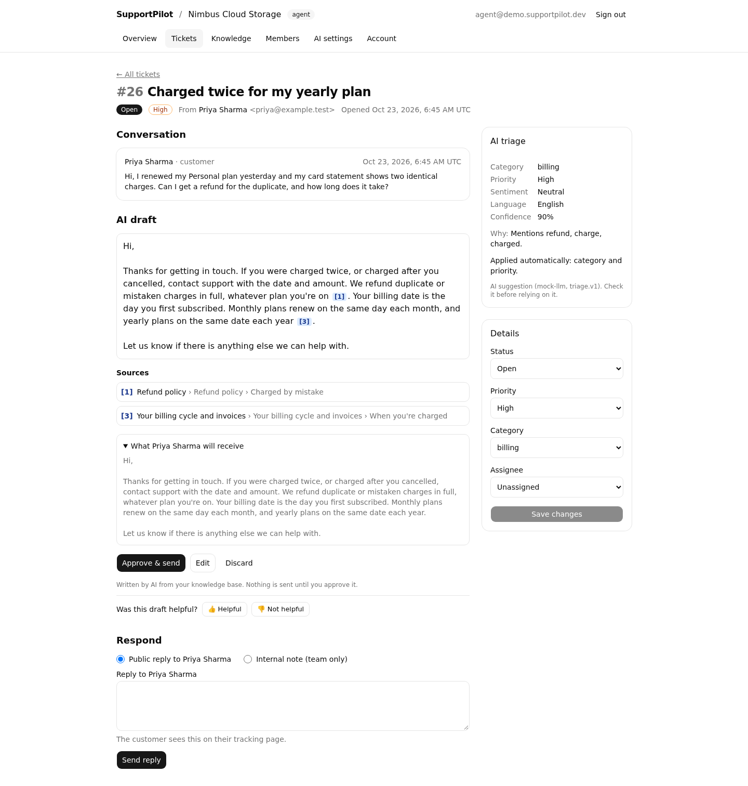 | 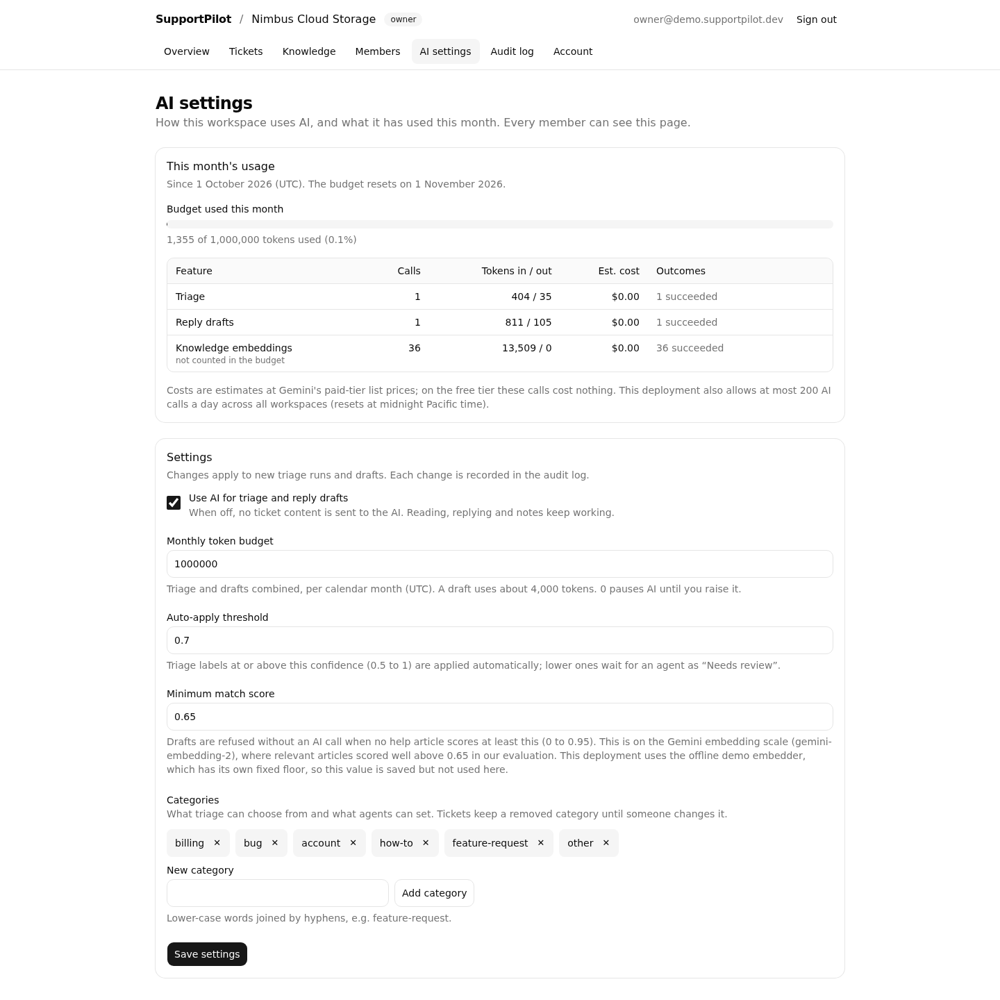 |

| A citation opened                                     | Draft on a phone                                          |
| ----------------------------------------------------- | --------------------------------------------------------- |
| 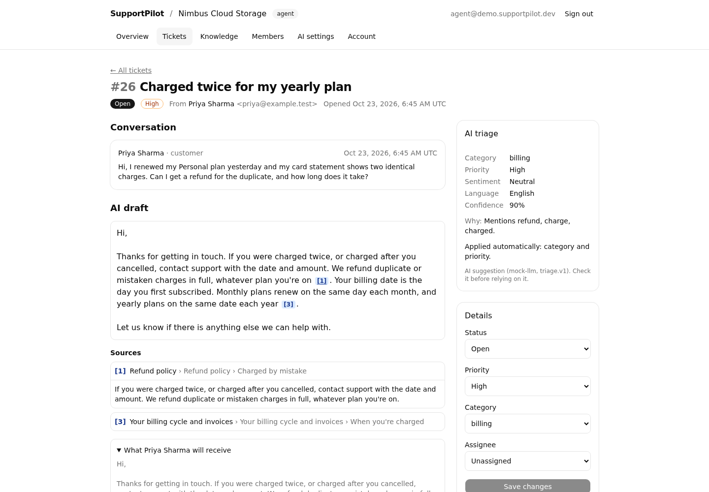 | 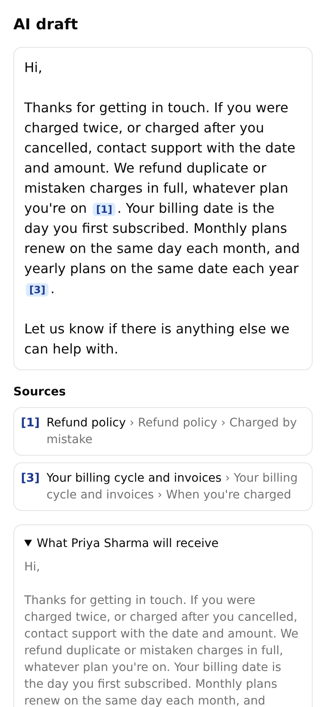 |

Screenshots use the offline mock AI, which builds its answer from the retrieved passages; real Gemini drafts are in the report above.

**Knowledge base** (the help articles AI drafts cite)

- Admins upload **Markdown, text or PDF** files. Uploads follow the OWASP file-upload rules: extension allowlist plus content check, size and quota limits, and files are never served back.
- A **background worker** (pg-boss on PostgreSQL) extracts text, splits it into passages and embeds them. **PDFs are parsed in a sandboxed thread** with a memory cap and a hard 30 s kill ([ADR-0013](docs/adr/0013-embeddings-and-pdf-sandbox.md)). Temporary failures are retried; bad files fail with a plain-language reason.
- **Measured search:** passages are ranked by meaning (Gemini `gemini-embedding-2` embeddings in pgvector), and a PostgreSQL full-text search labels keyword matches. Equal-weight hybrid fusion was the plan, but on a 110-question eval meaning alone ranked better (recall@5 99.1% vs 97.3%), so it was dropped ([ADR-0014](docs/adr/0014-retrieval-ranking.md)). Admins can try it on a **test search** page that shows why each passage was found.
- **Measured, not assumed:** `pnpm eval:retrieval` runs the real pipeline on a synthetic 35-article help centre with 110 labelled questions and reports recall@5, MRR@5, latency, tokens and cost. CI guards the baseline on every push ([retrieval baseline](docs/eval/retrieval-baseline.md)).

| Knowledge base                                               | Test search                                            |
| ------------------------------------------------------------ | ------------------------------------------------------ |
| 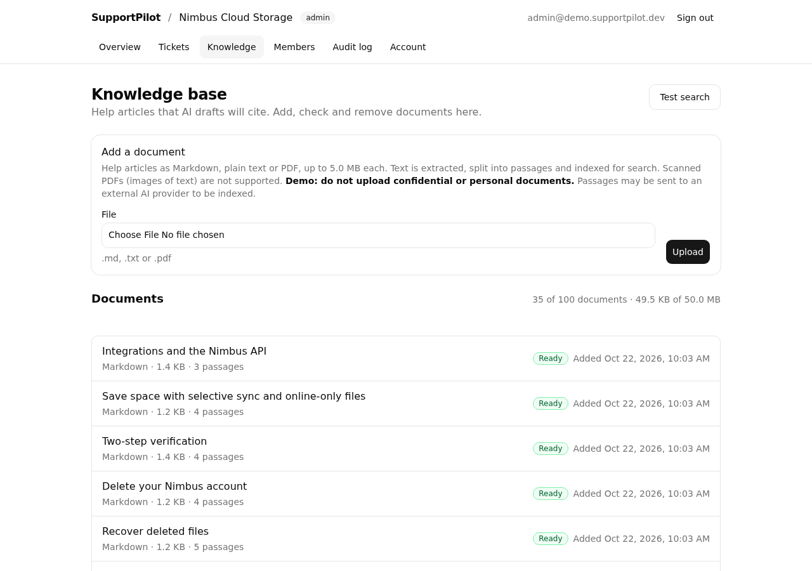 | 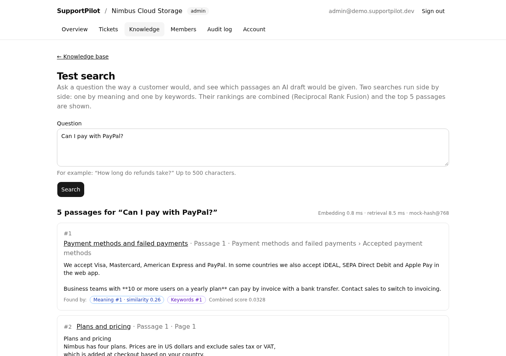 |

**Ticketing**

- A public **customer portal** per workspace (`/p/{slug}`). Customers need no account: they get a **private tracking link** to follow the conversation and reply. The link is a 256-bit random token, only its hash is stored, and it is kept out of referrers, caches, search engines and logs ([ADR-0012](docs/adr/0012-tracking-link.md)).
- An **agent inbox** with status tabs and counts, full-text search (`#12`, `-exclude`), filters, and keyset paging. Filters live in the URL.
- A **ticket page** with the conversation, public replies vs **internal notes**, and status, priority, category and assignee. Internal notes never reach customers (tested at service, API and browser level).
- Ticket lifecycle rules (`closed` is final, a customer reply reopens a resolved ticket). **Concurrent edits are detected**, so nobody overwrites a colleague's change. Every change is in the audit log.
- Portal abuse controls: rate limits per IP, per workspace and per ticket, a honeypot, and size limits.
- A documented **REST API** (OpenAPI 3.1) on the same services, with cross-workspace access tests for every route.

**Foundation**

- Email + password accounts (NIST SP 800-63B-4 password rules, optional breached-password check), database sessions, sign-out everywhere on password change.
- Multi-tenant **workspaces**: create, switch, invite by single-use 7-day link, change roles, remove members. Roles **owner / admin / agent** are enforced on the server for every action. Cross-workspace access is tested.
- Append-only **audit log** of membership and ticket changes.
- Strict per-request **nonce Content Security Policy** (no inline scripts), rate limiting, CSRF/origin checks.
- Accessible, responsive UI. Automated axe scans find 0 serious issues on desktop and mobile.

| Agent inbox                                           | Ticket with an internal note                           |
| ----------------------------------------------------- | ------------------------------------------------------ |
| 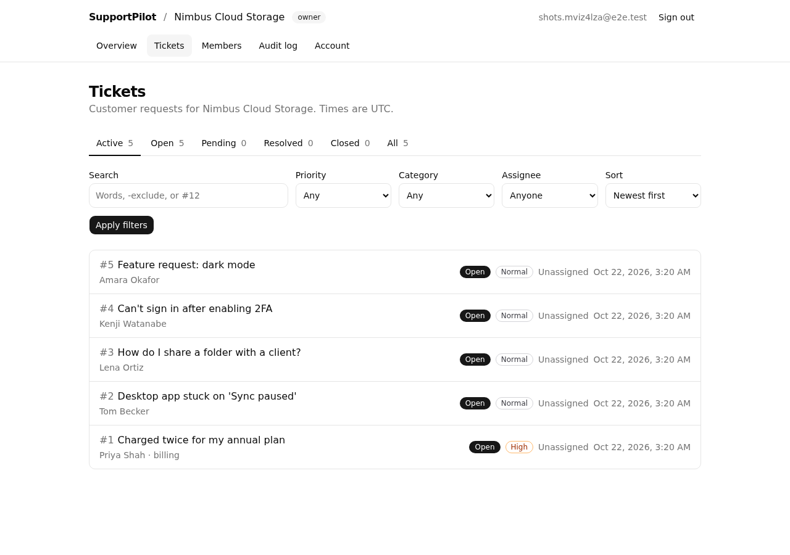 | 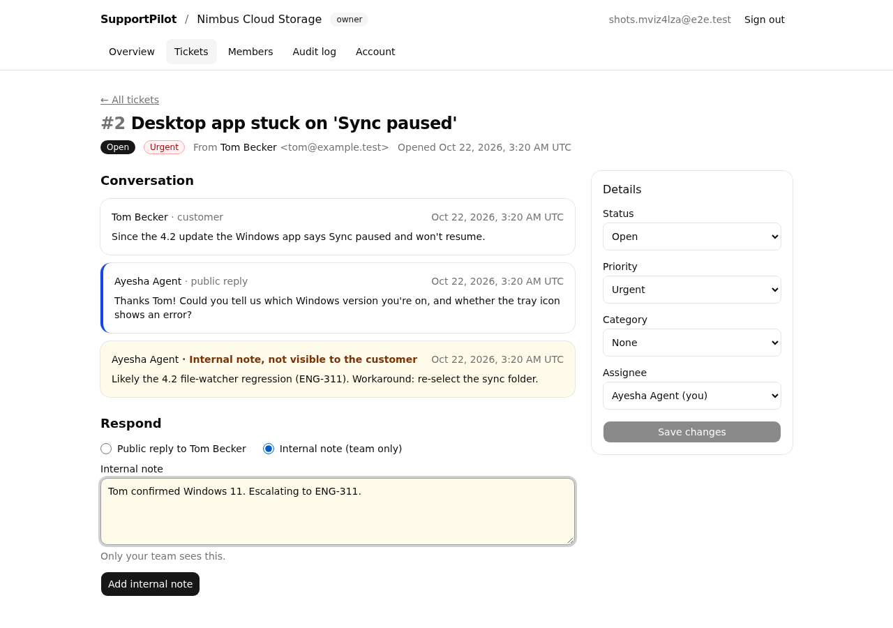 |

| Customer portal (phone)                                    | Customer tracking page (phone)                                 | Members (owner view)                                   |
| ---------------------------------------------------------- | -------------------------------------------------------------- | ------------------------------------------------------ |
| 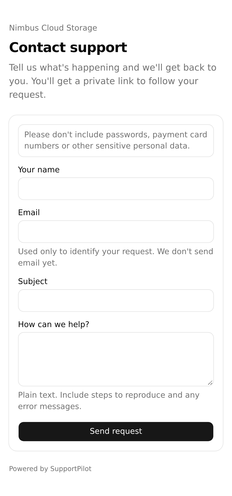 | 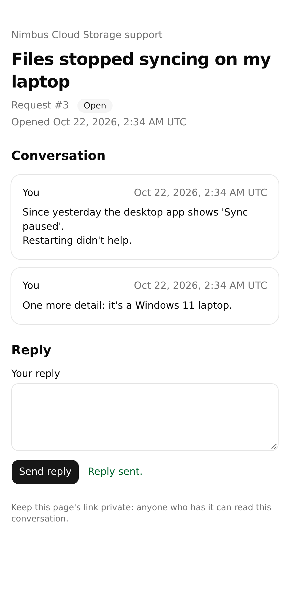 | 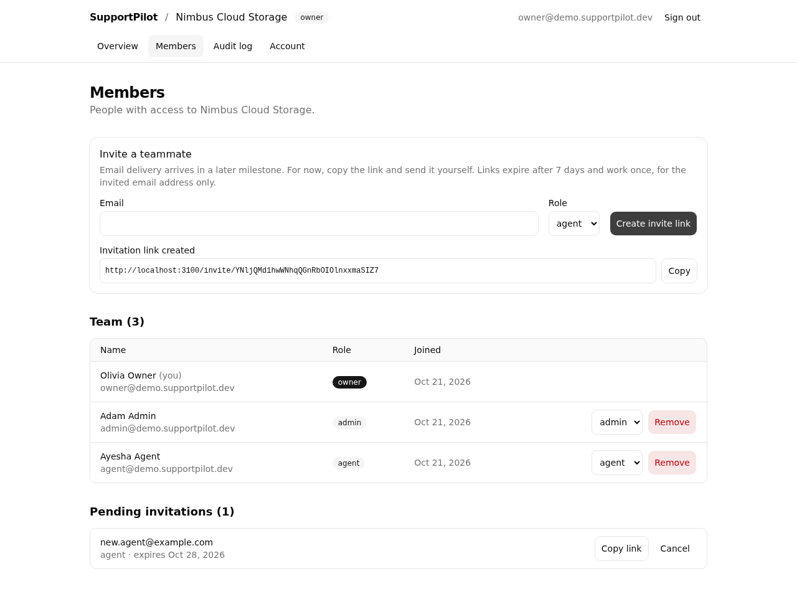 |

## Quick start (local)

Prerequisites: Node.js 24 (`.nvmrc`), pnpm via Corepack (`corepack enable`), Docker.

```bash
cp .env.example .env.local          # dev-only defaults
docker compose up -d db             # PostgreSQL 17 + pgvector (creates the test DB too)
pnpm install --frozen-lockfile
pnpm db:migrate                     # apply SQL migrations + install job queues
pnpm dev                            # http://localhost:3000
pnpm worker                         # background jobs (document ingestion, triage), in a second terminal
DEMO_PASSWORD='choose a long passphrase' pnpm db:seed-demo   # optional demo workspace
```

The demo seed creates "Nimbus Cloud Storage" with `owner@`, `admin@` and `agent@demo.supportpilot.dev`, all using your `DEMO_PASSWORD`, plus **25 synthetic tickets** and a **35-article help centre** as its knowledge base (queued for the worker, ready within a minute or so). Every person and company in them is invented, and addresses use reserved `.test`/`.example` domains. The tickets carry correct category and priority labels and double as the evaluation set for AI triage (M5/M6). Running the seed again is safe: it only adds tickets and articles to an empty workspace.

Switched `AI_PROVIDER` after seeding (e.g. from `mock` to `gemini`)? Search then refuses to compare vectors from two models; run `pnpm kb:reembed --workspace nimbus-demo` with the new settings.

Run the production image locally instead (web, worker and the migration step from one image):

```bash
export BETTER_AUTH_SECRET="$(openssl rand -base64 32)"
docker compose --profile full up --build
```

## Scripts

| Command                           | What it does                                                                                                     |
| --------------------------------- | ---------------------------------------------------------------------------------------------------------------- |
| `pnpm check`                      | lint + typecheck + format check + unit tests                                                                     |
| `pnpm test:coverage`              | unit tests with coverage thresholds (80% lines/functions)                                                        |
| `pnpm test:integration`           | tests against real PostgreSQL (`TEST_DATABASE_URL`)                                                              |
| `pnpm test:smoke`                 | checks against a running server (`SMOKE_BASE_URL`) and worker (`SMOKE_DATABASE_URL`)                             |
| `pnpm test:e2e`                   | Playwright + axe against the production build (run `pnpm build` and `pnpm db:migrate` first)                     |
| `pnpm build`                      | production build (needs **no** runtime secrets)                                                                  |
| `pnpm worker`                     | background worker from source (needs only `DATABASE_URL` and `AI_PROVIDER`)                                      |
| `pnpm build:scripts`              | bundle the worker, its PDF thread and the migration script into `.build/`                                        |
| `pnpm db:generate` / `db:migrate` | create / apply migrations                                                                                        |
| `pnpm db:seed-demo`               | demo workspace, users, tickets and knowledge base (needs `DEMO_PASSWORD`)                                        |
| `pnpm eval`                       | the full evaluation with 95% intervals (`--check-floors`, `--provider gemini`, `--resume`, `--triage-prompt v2`) |
| `pnpm eval:retrieval`             | retrieval eval: recall@5, MRR@5, latency, cost (`--grid`, `--provider gemini`)                                   |
| `pnpm eval:threshold`             | refusal threshold analysis from cached Gemini embeddings (no API calls)                                          |
| `pnpm kb:reembed`                 | re-embed a workspace's knowledge base after changing the embedding model                                         |
| `pnpm eval:ai`                    | AI smoke run: triage, drafts and the injection set (`--provider gemini`, budgeted and paced)                     |
| `pnpm eval:review`                | `load` the human spot-check items into the database, `status`, or `export` the verdicts to `eval/review/*.json`  |
| `pnpm otel:capture`               | a local trace receiver that prints each span (`--out spans.jsonl`); see [observability](docs/observability.md)   |
| `pnpm sentry:check`               | send one test error to Sentry through the app's reporting path (needs `SENTRY_DSN`)                              |

## Configuration

All settings are environment variables. Most are validated at startup (`src/server/platform/env.ts`), and the server exits if one is invalid. `.env.example` has local defaults.

| Variable                                                          | Default                            | Purpose                                                                                                                                                                                                                                                        |
| ----------------------------------------------------------------- | ---------------------------------- | -------------------------------------------------------------------------------------------------------------------------------------------------------------------------------------------------------------------------------------------------------------- |
| `DATABASE_URL`                                                    | (required)                         | PostgreSQL 17 with pgvector                                                                                                                                                                                                                                    |
| `BETTER_AUTH_SECRET`                                              | (required)                         | Session signing secret, at least 32 characters (`openssl rand -base64 32`)                                                                                                                                                                                     |
| `BETTER_AUTH_URL`                                                 | (required)                         | Public URL of the app. Also the only origin allowed to send cookie-authenticated writes                                                                                                                                                                        |
| `AUTH_TRUSTED_ORIGINS`                                            | none                               | Extra allowed origins, comma-separated (e.g. a preview URL)                                                                                                                                                                                                    |
| `AUTH_RATE_LIMIT_ENABLED`                                         | `true`                             | Sign-in / sign-up rate limits. Disable only in tests                                                                                                                                                                                                           |
| `PORTAL_RATE_LIMIT_ENABLED`                                       | `true`                             | Portal submission and reply limits. Disable only in tests                                                                                                                                                                                                      |
| `AUTH_PASSWORD_BREACH_CHECK`                                      | `true`                             | Have I Been Pwned range check on new passwords. Fails closed: if the API can't be reached, the password is refused                                                                                                                                             |
| `TRUST_PROXY_HEADERS`                                             | `false`                            | Read the client IP from `X-Forwarded-For` for per-IP portal limits. **Enable only behind a proxy that overwrites that header.** Otherwise anyone can fake their IP. While off, all clients share one per-IP bucket ([AR-004](docs/security/accepted-risks.md)) |
| `CSP_FRAME_ANCESTORS`                                             | `'none'`                           | Origins allowed to embed the app in a frame. Read by the proxy: an invalid value falls back to `'none'` (no framing) instead of stopping the server                                                                                                            |
| `GITHUB_CLIENT_ID` / `GITHUB_CLIENT_SECRET`                       | none                               | Optional GitHub sign-in                                                                                                                                                                                                                                        |
| `AI_PROVIDER`                                                     | `mock` (must be set in production) | `gemini` for real embeddings, triage and drafts; `mock` for deterministic offline AI (tests, local work). Production must choose explicitly, so a deployment never silently runs on fake AI                                                                    |
| `GEMINI_API_KEY`                                                  | none                               | Google AI Studio key, required when `AI_PROVIDER=gemini`. Free-tier inputs may be used by Google to improve its products: demo data only                                                                                                                       |
| `AI_DAILY_CALL_LIMIT`                                             | `200`                              | Triage + draft calls per day for the whole deployment, counted per Pacific-time day (when Google resets free quotas). `0` turns AI generation off                                                                                                              |
| `EVAL_REVIEWER_EMAILS`                                            | none                               | Sign-in emails (comma-separated) allowed to open the evaluation Review page, `/app/review`. Unset: off (no link; the page and its API answer 404)                                                                                                              |
| `OTEL_EXPORTER_OTLP_ENDPOINT`                                     | none                               | OpenTelemetry traces over OTLP/HTTP (e.g. `http://localhost:4318`). Unset: no tracing code runs. Only allowlisted metadata is exported, never customer text ([observability](docs/observability.md))                                                           |
| `OTEL_EXPORTER_OTLP_HEADERS`                                      | none                               | Headers for a hosted tracing backend that needs a key (`name=value`)                                                                                                                                                                                           |
| `SENTRY_DSN`                                                      | none                               | Report server errors to Sentry, with personal data collection switched off. Check it with `pnpm sentry:check`                                                                                                                                                  |
| `SENTRY_ENVIRONMENT`                                              | `NODE_ENV`                         | Environment name shown in Sentry (letters, digits, `.` `_` `-`)                                                                                                                                                                                                |
| `LOG_LEVEL`, `DATABASE_POOL_MAX`, `DATABASE_STATEMENT_TIMEOUT_MS` | `info`, `10`, `10000`              | Logging and database tuning                                                                                                                                                                                                                                    |

## Operational endpoints

| Endpoint                                       | Who                         |
| ---------------------------------------------- | --------------------------- |
| `POST /api/v1/portal/{slug}/tickets`           | public (rate limited)       |
| `GET /api/v1/portal/t/{token}`                 | customer with tracking link |
| `POST /api/v1/portal/t/{token}/messages`       | customer with tracking link |
| `GET /api/v1/tickets`                          | workspace member            |
| `GET` / `PATCH /api/v1/tickets/{id}`           | workspace member            |
| `POST /api/v1/tickets/{id}/messages`           | workspace member            |
| `GET /api/v1/kb/documents`                     | workspace member            |
| `GET /api/v1/kb/documents/{id}`                | workspace member            |
| `POST /api/v1/kb/documents` (multipart upload) | admin or owner              |
| `DELETE /api/v1/kb/documents/{id}`             | admin or owner              |
| `POST /api/v1/kb/documents/{id}/retry`         | admin or owner              |
| `POST /api/v1/kb/search` (test search)         | admin or owner              |
| `POST /api/v1/tickets/{id}/drafts` (streamed)  | workspace member            |
| `POST /api/v1/drafts/{id}/send`                | workspace member            |
| `POST /api/v1/drafts/{id}/discard`             | workspace member            |
| `POST /api/v1/drafts/{id}/feedback`            | workspace member            |
| `POST /api/v1/tickets/{id}/triage/accept`      | workspace member            |
| `GET /api/v1/settings/ai`                      | workspace member            |
| `PATCH /api/v1/settings/ai`                    | admin or owner              |

Agent endpoints use the browser session and accept writes only from the app's own origin.

## Quality gates (CI)

Lint (incl. accessibility rules, zero warnings) · strict typecheck · Prettier · unit tests + coverage · integration tests on PostgreSQL + pgvector (including the 20-case prompt-injection set) · production build + smoke tests · Playwright E2E + axe accessibility scans (fail on any CSP violation) · fail-fast config check · Docker build + container smoke (non-root, HEALTHCHECK) · CodeQL · gitleaks · dependency review · `pnpm audit` (production deps blocking). All actions are pinned to commit SHAs. Dependabot keeps them current.

## Documentation

| Doc                                                       | Contents                                                                |
| --------------------------------------------------------- | ----------------------------------------------------------------------- |
| [00 · Research & plan](docs/00-research-and-plan.md)      | Market research with sources, stack choice, roadmap                     |
| [01 · Requirements](docs/01-requirements.md)              | Roles, functional & non-functional requirements, acceptance criteria    |
| [02 · Architecture](docs/02-architecture.md)              | System design, data model, API contract, key flows                      |
| [03 · Threat model](docs/03-threat-model.md)              | STRIDE, OWASP Top 10:2025 and OWASP LLM Top 10 2026 mapping             |
| [04 · AI evaluation plan](docs/04-ai-evaluation-plan.md)  | Golden dataset, metrics, targets                                        |
| [ADRs](docs/adr/)                                         | Architecture decision records                                           |
| [Accepted risks](docs/security/accepted-risks.md)         | Known limitations with mitigations and a revisit date                   |
| [M3 plan](docs/plans/m3-ticketing.md)                     | Ticketing design decisions D1–D10 and the "done when" list              |
| [M4 plan](docs/plans/m4-knowledge-base.md)                | Knowledge-base decisions D1–D14 and the "done when" list                |
| [M5 plan](docs/plans/m5-ai-features.md)                   | AI features: models, guardrails, the injection set, "done when"         |
| [Retrieval baseline](docs/eval/retrieval-baseline.md)     | Search quality method, results and limitations                          |
| [Gemini smoke run](docs/eval/ai-smoke-2026-10-23.md)      | Triage, draft and prompt-injection results with real models             |
| [Observability](docs/observability.md)                    | Logs, traces and Sentry: what is collected, what never is, how to check |
| [Milestone log](docs/milestones.md)                       | What was built and verified in each milestone                           |
| [Contributing](CONTRIBUTING.md) · [Security](SECURITY.md) | Workflow, AI-assisted development policy, vulnerability reporting       |

## License

[MIT](LICENSE)
