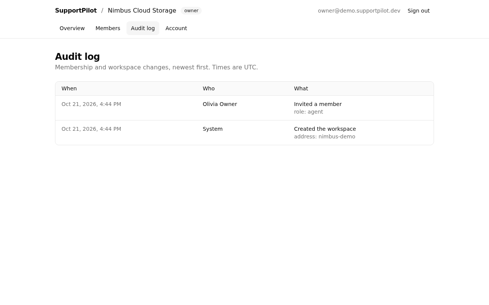

# SupportPilot

AI-assisted customer support with **grounded, cited answers** and a **human in the loop**.

> 🚧 **Status: M0–M2 complete: foundation, accounts, workspaces and roles.** Ticketing and AI features arrive in M3–M5. See the [roadmap](docs/00-research-and-plan.md#5-implementation-roadmap-one-verifiable-milestone-at-a-time).

## Tech stack

TypeScript (strict) · Next.js 16 (App Router) · React 19 · Node.js 24 LTS · PostgreSQL 17 + pgvector · Drizzle ORM · Better Auth · Tailwind CSS + shadcn/ui · Zod · pino · Vitest · Playwright + axe · Docker · GitHub Actions.
Reasons for each choice are in [`docs/adr/`](docs/adr/).

## What works today (M2)

- Email + password accounts (NIST SP 800-63B-4 password rules, optional breached-password check), database sessions, sign-out everywhere on password change.
- Multi-tenant **workspaces**: create, switch, invite by single-use 7-day link, change roles, remove members. Roles **owner / admin / agent** are enforced on the server for every action. Cross-workspace access is tested.
- Append-only **audit log** of membership changes.
- Strict per-request **nonce Content Security Policy** (no inline scripts), rate limiting, CSRF/origin checks.
- Accessible, responsive UI. Automated axe scans find 0 serious issues on desktop and mobile.

| Members (owner view)                                   | Audit log                                       |
| ------------------------------------------------------ | ----------------------------------------------- |
|  |  |

## Quick start (local)

Prerequisites: Node.js 24 (`.nvmrc`), pnpm via Corepack (`corepack enable`), Docker.

```bash
cp .env.example .env.local          # dev-only defaults
docker compose up -d db             # PostgreSQL 17 + pgvector (creates the test DB too)
pnpm install --frozen-lockfile
pnpm db:migrate                     # apply SQL migrations
pnpm dev                            # http://localhost:3000
DEMO_PASSWORD='choose a long passphrase' pnpm db:seed-demo   # optional demo workspace
```

The demo seed creates "Nimbus Cloud Storage" with `owner@`, `admin@` and `agent@demo.supportpilot.dev`, all using your `DEMO_PASSWORD`.

Run the production image locally instead: `docker compose --profile full up --build`.

## Scripts

| Command                           | What it does                                                                                 |
| --------------------------------- | -------------------------------------------------------------------------------------------- |
| `pnpm check`                      | lint + typecheck + format check + unit tests                                                 |
| `pnpm test:coverage`              | unit tests with coverage thresholds (80% lines/functions)                                    |
| `pnpm test:integration`           | tests against real PostgreSQL (`TEST_DATABASE_URL`)                                          |
| `pnpm test:smoke`                 | HTTP checks against a running server (`SMOKE_BASE_URL`)                                      |
| `pnpm test:e2e`                   | Playwright + axe against the production build (run `pnpm build` and `pnpm db:migrate` first) |
| `pnpm build`                      | production build (needs **no** runtime secrets)                                              |
| `pnpm db:generate` / `db:migrate` | create / apply migrations                                                                    |

## Operational endpoints

| Endpoint          | Purpose                                                                  |
| ----------------- | ------------------------------------------------------------------------ |
| `GET /api/health` | liveness: process is serving (does not touch DB)                         |
| `GET /api/ready`  | readiness: DB reachable. Returns `503` + RFC 9457 problem details if not |

The server **refuses to start** (exit 1) when configuration is invalid. Every response carries an `x-request-id` that matches the structured JSON logs.

## REST API (`/api/v1`)

The machine-readable contract is served at **`GET /api/v1/openapi.json`** (OpenAPI 3.1), generated from the same Zod schemas that validate requests. Errors use RFC 9457 Problem Details.

| Endpoint                                 | Who                         |
| ---------------------------------------- | --------------------------- |
| `POST /api/v1/portal/{slug}/tickets`     | public (rate limited)       |
| `GET /api/v1/portal/t/{token}`           | customer with tracking link |
| `POST /api/v1/portal/t/{token}/messages` | customer with tracking link |
| `GET /api/v1/tickets`                    | workspace member            |
| `GET` / `PATCH /api/v1/tickets/{id}`     | workspace member            |
| `POST /api/v1/tickets/{id}/messages`     | workspace member            |

Agent endpoints use the browser session and accept writes only from the app's own origin.

## Quality gates (CI)

Lint (incl. accessibility rules, zero warnings) · strict typecheck · Prettier · unit tests + coverage · integration tests on PostgreSQL + pgvector · production build + smoke tests · Playwright E2E + axe accessibility scans (fail on any CSP violation) · fail-fast config check · Docker build + container smoke (non-root, HEALTHCHECK) · CodeQL · gitleaks · dependency review · `pnpm audit` (production deps blocking). All actions are pinned to commit SHAs. Dependabot keeps them current.

## Documentation

| Doc                                                       | Contents                                                             |
| --------------------------------------------------------- | -------------------------------------------------------------------- |
| [00 · Research & plan](docs/00-research-and-plan.md)      | Market research with sources, stack choice, roadmap                  |
| [01 · Requirements](docs/01-requirements.md)              | Roles, functional & non-functional requirements, acceptance criteria |
| [02 · Architecture](docs/02-architecture.md)              | System design, data model, API contract, key flows                   |
| [03 · Threat model](docs/03-threat-model.md)              | STRIDE, OWASP Top 10:2025 and OWASP LLM Top 10 mapping               |
| [04 · AI evaluation plan](docs/04-ai-evaluation-plan.md)  | Golden dataset, metrics, targets                                     |
| [ADRs](docs/adr/)                                         | Architecture decision records                                        |
| [Milestone log](docs/milestones.md)                       | What was built and verified in each milestone                        |
| [Contributing](CONTRIBUTING.md) · [Security](SECURITY.md) | Workflow, AI-assisted development policy, vulnerability reporting    |

## License

[MIT](LICENSE)
