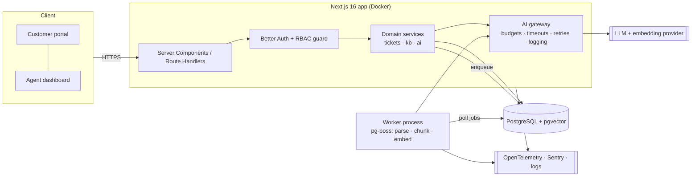

# SupportPilot: Research, Recommendation & Roadmap

> Status: **APPROVED 2026-10-19.** Decisions recorded in §6. Detailed design lives in docs 01–04 and `docs/adr/`.
> Research date: 2026-10-18. All figures come from the linked sources. Where a source is a third party with a methodology I could not check, it is marked **[3rd-party]**.

---

## 1. Research findings

### 1.1 Developer adoption (Stack Overflow Developer Survey 2026, n = 30,903, 169 countries, published 2026-10-06)

| Area           | Finding                                                                                                                               | Source                                                                                                                          |
| -------------- | ------------------------------------------------------------------------------------------------------------------------------------- | ------------------------------------------------------------------------------------------------------------------------------- |
| Languages      | JavaScript 62.0%, SQL 58.4%, HTML/CSS 58.2%, Python 58.0%, TypeScript 43.8%                                                           | [SO 2026 – languages](https://survey.stackoverflow.co/2026/technology/data/languages)                                           |
| Web frameworks | Node.js 46.4%, React 41.5%, Next.js 20.6%, FastAPI 18.5%                                                                              | [SO 2026 – web frameworks](https://survey.stackoverflow.co/2026/technology/data/web-framework)                                  |
| Databases      | PostgreSQL 57.9% (#1), used by a majority of respondents                                                                              | [SO 2026 – technology](https://survey.stackoverflow.co/2026/technology)                                                         |
| Cloud/tooling  | Docker/Compose 59.1% (#1), AWS 41.8%, Kubernetes 26.0%, Azure 25.1%, Cloudflare 24.6%, GCP 24.5%                                      | [SO 2026 – technology data](https://survey.stackoverflow.co/2026/technology/data)                                               |
| AI usage       | 66% use coding assistants/agents; only 17.2% use no AI tools                                                                          | [SO press release](https://stackoverflow.co/company/press/archive/stack-overflow-annual-developer-survey-ai-trust-conditional/) |
| AI trust       | 48.0% trust AI output "when I can easily verify it"; 6.6% trust it for important decisions; 78.7% say source attribution is important | [SO 2026 – AI trust](https://survey.stackoverflow.co/2026/ai/data/ai-trust)                                                     |
| Security       | Only ~23% used security tooling in the past year; 23.5% lost time to AI-related security/privacy issues                               | [SO 2026 – technology](https://survey.stackoverflow.co/2026/technology)                                                         |

Caveat: respondents choose to take the survey, so the sample is not random. Treat these numbers as trends, not as market share.

### 1.2 GitHub Octoverse 2025 (latest edition I could find)

- In August 2025 TypeScript became the **#1 language on GitHub by monthly contributors** (2,636,006, +66.6% YoY), ahead of Python and JavaScript. ([GitHub blog](https://github.blog/news-insights/octoverse/octoverse-a-new-developer-joins-github-every-second-as-ai-leads-typescript-to-1/))
- Python leads in AI-tagged repositories. ([GitHub blog](https://github.blog/news-insights/octoverse/what-the-fastest-growing-tools-reveal-about-how-software-is-being-built/))
- More than 1.1M public repos import an LLM SDK, +178% YoY. ([Visual Studio Magazine on Octoverse](https://visualstudiomagazine.com/articles/2025/10/31/typescript-tops-github-octoverse-as-ai-era-reshapes-language-choices.aspx))

### 1.3 Hiring demand

- **Indeed Hiring Lab (US data):** software-development postings are up ~15% since Feb 2025, but still ~27.5% below the pre-pandemic level. 71% of the increase (May 2025 → May 2026) came from **senior roles**, and 37% from roles with **AI in the title**. ([Indeed Hiring Lab](https://www.hiringlab.org/2026/07/08/ai-and-job-postings-from-destruction-to-creation/))
- Only **4.5%** of US software-development postings in Q1 2026 were entry-level, and 69.3% were senior. ([Indeed Hiring Lab](https://hiringlab.indeed.com/2026/07/23/the-labor-market-is-tilting-toward-seniority/))
- **[3rd-party]** analysis of 48,207 SWE postings: Python 34.8%, AWS 26.5%, CI/CD 26.3%, SQL 21.9%, APIs 21.1%, TypeScript 17.7%, Docker 17.2%, Monitoring 16.2%, React 15.2%. ([InterviewStack](https://interviewstack.io/blog/software-engineer-skills-companies-want-2026))
- **[3rd-party]** analysis of 360k postings: "AI" was the #2 requested skill (19.8%), ahead of every individual language. ([Qarera](https://www.qarera.com/reports/most-in-demand-skills-2026))

**What this means for the portfolio:** demand is concentrated in senior and AI-capable engineers. A CRUD app will not stand out. The project has to show senior-level signals: system design, documented trade-offs, security, testing, operations, and **measured** AI quality. Indeed's data is US-focused. Remote and global markets differ, but the same skills keep appearing in postings everywhere.

### 1.4 Ecosystem facts that affect the stack choice

- **Next.js** is on 16.x (16.4 released 2026-10-06), and security releases come roughly every month (e.g., 16.3.8 on 2026-09-30). Automated dependency updates are therefore mandatory. ([Next.js blog](https://nextjs.org/blog), [Sept 2026 security release](https://nextjs.org/blog/september-2026-security-release))
- **Auth.js/NextAuth** has been maintained by the Better Auth team since Sept 2025. Its maintainers recommend **Better Auth for new projects**. ([GitHub discussion](https://github.com/nextauthjs/next-auth/discussions/13252), [Better Auth blog](https://better-auth.com/blog/authjs-joins-better-auth))
- **OWASP Top 10:2025** (A01 Broken Access Control … A10 Mishandling of Exceptional Conditions) ([owasp.org](https://owasp.org/Top10/2025/)) and the **OWASP Top 10 for LLM Applications 2025** ([genai.owasp.org](https://genai.owasp.org/resource/owasp-top-10-for-llm-applications-2025/)). One secondary site mentions a 2026 LLM edition that I could not find on the official site. I will check again at the security-review milestone. **Update 2026-10-22 (M5):** the 2026 edition is now published on the official OWASP GenAI repository (2026-08-04); the threat model was remapped to it.

---

## 2. Recommended project: **SupportPilot**

**An AI-assisted customer-support platform that gives grounded, cited answers and keeps a human in the loop.**

Why this project:

- **Business value:** support costs are real and measurable (first-response time, deflection rate, agent handle time).
- **Matches the trust data:** developers trust AI when it can be verified and when it cites sources. Every AI answer cites the knowledge-base passages it used. A human approves before anything goes to a customer.
- **Covers full stack plus AI:** multi-tenant SaaS, RBAC, background jobs, vector search, structured outputs, streaming UI, evaluation pipeline, and operations.
- **Measurable AI quality:** triage accuracy, retrieval recall, citation validity, latency, and cost can all be tested automatically.

### 2.1 Users

| Persona                                          | Goal                                                                                        |
| ------------------------------------------------ | ------------------------------------------------------------------------------------------- |
| **Workspace owner/admin**                        | Set up the workspace, invite team, manage knowledge sources and AI settings, view analytics |
| **Support agent**                                | Work the ticket queue, review and edit AI drafts, override AI triage, flag bad answers      |
| **End customer** (unauthenticated or magic-link) | Submit a ticket, get a fast and accurate answer, track status                               |

### 2.2 Core features (MVP)

1. **Multi-tenant workspaces + RBAC** (owner / admin / agent), invitations, audit log.
2. **Ticketing:** public submission portal, agent queue, statuses, assignment, internal notes, search/filter.
3. **Knowledge base ingestion:** upload Markdown / TXT / PDF, then a background job parses, chunks, and embeds the content into pgvector.
4. **AI triage:** structured output (category, priority, sentiment, language, confidence). Agents can override, and each override is logged as evaluation data.
5. **AI draft replies (RAG):** streamed draft with inline citations. If retrieval confidence is too low, it answers "insufficient knowledge" instead. **An agent must approve before sending.**
6. **Analytics:** AI acceptance rate, edit ratio, latency p50/p95, tokens and cost per ticket, tickets by category.

**Stretch (after MVP):** customer-facing self-service answers (deflection), URL import (with SSRF controls), email channel, PII redaction before LLM calls.

**Out of scope:** billing, mobile apps, fully autonomous replies with no human approval.

### 2.3 Acceptance criteria (targets are checked by tests, scans, or measurements)

| Area             | Criterion                                                                                                                             | How it is verified                         |
| ---------------- | ------------------------------------------------------------------------------------------------------------------------------------- | ------------------------------------------ |
| Tenant isolation | Every resource endpoint returns 404 for cross-tenant access; 100% of resource routes covered                                          | Automated integration test suite           |
| AuthZ            | Role matrix enforced server-side for every mutation                                                                                   | Table-driven tests                         |
| Input validation | All API inputs validated with Zod; invalid input → 400 with no stack trace                                                            | Tests + error-format contract test         |
| Security scans   | 0 high/critical findings from CodeQL, dependency audit, secret scan, OWASP ZAP baseline at release                                    | CI artifacts                               |
| Accessibility    | 0 serious/critical axe violations on key pages; keyboard-only flows work; WCAG 2.2 AA target                                          | Playwright + axe in CI, manual check       |
| Performance      | Non-AI API p95 < 300 ms at demo load; Lighthouse perf ≥ 90 on portal                                                                  | k6 run + Lighthouse CI (results published) |
| AI triage        | Category accuracy ≥ 85% on golden set (n ≈ 150)                                                                                       | Eval runner                                |
| Retrieval        | Recall@5 ≥ 90% on labelled Q→passage pairs                                                                                            | Eval runner                                |
| Citations        | 100% of citations point to chunks that were actually retrieved (deterministic check); groundedness judged on a human-validated sample | Eval runner + manual review                |
| Refusal          | ≥ 90% of out-of-scope questions get "insufficient knowledge"                                                                          | Eval runner                                |
| AI latency/cost  | Time-to-first-token p95 and cost per draft measured and reported; budget cap per workspace enforced                                   | Telemetry + tests                          |
| Resilience       | If the LLM provider is down, ticketing still works; AI shows a clear error and can be retried                                         | Fault-injection test                       |
| Delivery         | Every PR: lint, typecheck, tests, build, scans; deploy on merge; documented rollback                                                  | GitHub Actions history                     |

The AI targets are **starting hypotheses**. I will measure a baseline first and then report the real numbers, even if they miss the targets.

---

## 3. Technology stack (only what has a purpose)

| Layer           | Choice                                                                                   | Why                                                                                                                             |
| --------------- | ---------------------------------------------------------------------------------------- | ------------------------------------------------------------------------------------------------------------------------------- |
| Language        | **TypeScript (strict)** end-to-end                                                       | #1 on GitHub; one language means shared types between client, server, and AI schemas                                            |
| Framework       | **Next.js 16 (App Router) + React 19** on **Node.js LTS**                                | React #2 and Node #1 in SO 2026; server components and route handlers remove the need for a separate API server                 |
| UI              | Tailwind CSS + shadcn/ui (Radix primitives)                                              | Accessible primitives (focus management, ARIA) with no design-system lock-in                                                    |
| Validation      | **Zod**                                                                                  | One schema serves API validation, form validation, and LLM structured output                                                    |
| Database        | **PostgreSQL 17 + pgvector**                                                             | #1 database in SO 2026; keeps vectors next to relational data, so no extra vector DB to run                                     |
| ORM/migrations  | **Drizzle ORM + drizzle-kit**                                                            | SQL-first, typed, native pgvector column type, versioned SQL migrations (engineering judgement; Prisma is the main alternative) |
| Auth            | **Better Auth** (email+password, GitHub OAuth, organizations plugin)                     | Recommended by the Auth.js maintainers for new projects; DB-backed sessions; built-in org/RBAC support                          |
| Background jobs | **pg-boss** (Postgres-backed queue)                                                      | Ingestion and embedding run asynchronously with retries, without adding Redis                                                   |
| AI              | **Vercel AI SDK** + one LLM provider + one embedding model                               | Provider-agnostic, streaming, Zod structured outputs; switching providers is a config change                                    |
| Testing         | Vitest, Testcontainers (real Postgres), Playwright + axe-core, k6, custom AI eval runner | Each one targets a specific acceptance criterion                                                                                |
| Observability   | pino structured logs, OpenTelemetry (Next.js built-in instrumentation hook), Sentry      | Request tracing, LLM latency/token spans, error alerting                                                                        |
| Containers      | **Docker** multi-stage image + Docker Compose for local dev                              | #1 tool in SO 2026; the same image runs in CI and prod                                                                          |
| CI/CD           | **GitHub Actions**, Dependabot, CodeQL, gitleaks, ZAP baseline                           | Covers OWASP A03 (supply chain) and the monthly Next.js security releases                                                       |
| Deploy          | Decision needed (see §6)                                                                 |                                                                                                                                 |

**Is Python justified?** Not for the core app. It would add a second runtime, deployment, and set of dependencies, and our RAG pipeline is simple enough that TypeScript handles it well. Python appears in about a third of SWE postings **[3rd-party]**, so an _optional_ Python evaluation/analytics service (FastAPI or a notebook-based eval report) can be added if you want to show Python skills. That choice is deliberate, not required.

---

## 4. Architecture

Key design rules:

- Every DB query is **scoped by `workspaceId`** through a repository layer, so no query skips the scope. This is tested per route (OWASP A01).
- The LLM **never** gets tools that can mutate data. Its output is treated as untrusted: rendered as escaped text or sanitized Markdown, and citations are validated against retrieved IDs (LLM05/LLM06, 2025 numbering; LLM10/LLM03 in the 2026 edition).
- System prompts contain **no secrets**. Retrieved documents are wrapped and labelled as data, not instructions. A prompt-injection test set runs in CI (LLM01/LLM07, 2025 numbering; LLM01/LLM08 in the 2026 edition).
- Per-workspace token budgets, request rate limits, and max input sizes (LLM10 Unbounded Consumption, 2025 numbering; LLM06 in the 2026 edition).

---

## 5. Implementation roadmap (one verifiable milestone at a time)

| #      | Milestone               | Deliverables                                                                                                                     | Exit criteria (verified)                                             |
| ------ | ----------------------- | -------------------------------------------------------------------------------------------------------------------------------- | -------------------------------------------------------------------- |
| **M0** | Requirements & design   | ADRs, ERD, API contract, threat model (STRIDE + OWASP), golden-dataset spec                                                      | Docs reviewed by you                                                 |
| **M1** | Foundation              | Repo, strict TS, lint/format, Docker Compose (Postgres+pgvector), Drizzle migrations, health endpoint, pino logging, CI skeleton | `docker compose up` works; CI green; `next build` passes             |
| **M2** | Auth & multi-tenancy    | Better Auth, workspaces, invites, RBAC, rate limiting, security headers/CSP, audit log                                           | Tenant-isolation and role-matrix tests pass                          |
| **M3** | Ticketing               | Portal, agent queue, ticket lifecycle, notes, accessible UI                                                                      | E2E journeys + axe checks pass                                       |
| **M4** | Knowledge ingestion     | Upload → worker → chunk → embed → HNSW index; retrieval API                                                                      | Ingestion integration tests; retrieval recall baseline recorded      |
| **M5** | AI features             | Triage (structured output), streamed RAG drafts with citations, approve/edit/send, failure handling, budgets                     | Unit tests with mocked LLM; fault-injection test; injection test set |
| **M6** | AI eval & observability | Golden set, eval runner (manual/nightly in CI to control cost), OTel traces, Sentry, analytics page                              | Eval report with accuracy, recall, latency, and cost numbers         |
| **M7** | Security review         | Threat-model review, ZAP baseline, CodeQL, dependency/secret scans, ASVS-based checklist                                         | 0 high/critical open, or documented with justification               |
| **M8** | Deployment              | Prod (+ staging) environment, migrations in pipeline, backups, alerts, runbook, rollback                                         | Live URL verified by a smoke test in CI                              |
| **M9** | Portfolio packaging     | README, diagram, screenshots, 3-min demo video script, case study with _measured_ results, limitations                           | Fresh-clone setup reproduced from the README                         |

**AI-assisted development policy** (documented in `CONTRIBUTING.md`): AI tools may draft code. Every change must pass typecheck, tests, and my review before it is committed. No secrets or real customer data go into prompts. Secrets live only in `.env` (gitignored) and the CI/cloud secret stores.

---

## 6. Decisions (approved 2026-10-19)

| Decision     | Choice                                                                                                    |
| ------------ | --------------------------------------------------------------------------------------------------------- |
| Project      | **SupportPilot**                                                                                          |
| Deployment   | **Low-cost containers** + managed Postgres/pgvector; platform picked at M8 (ADR-0008)                     |
| LLM provider | **Google Gemini API free tier**, plus a deterministic mock provider; provider-agnostic gateway (ADR-0006) |
| Python       | **Not included**: TypeScript only                                                                         |
| Owner time   | 5–10 h/week (review, approvals, account setup)                                                            |

## 7. Known limitations of this research

- Stack Overflow respondents are self-selected. Indeed data covers the US only. Third-party posting analyses could not be independently checked.
- The Octoverse 2026 edition was not published yet when I checked, so 2025 is the latest GitHub data.
- AI quality targets are hypotheses until the M6 baseline is measured.
