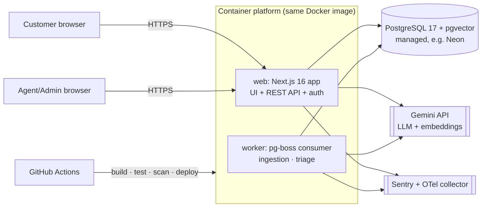
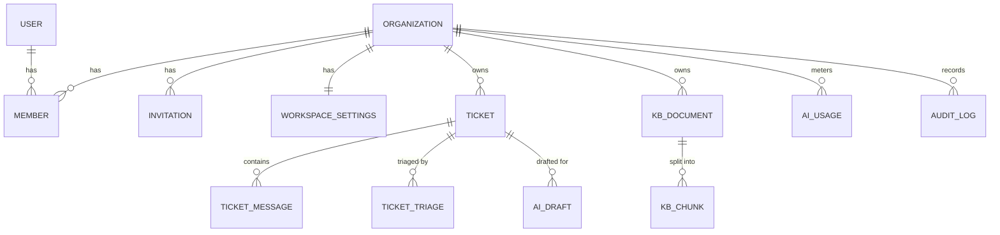
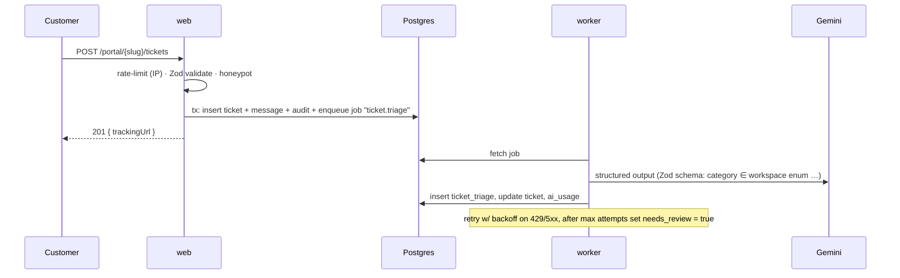

# 02 · Architecture

> Milestone M0 · Status: **Draft for review**. Decisions are explained in `docs/adr/`.

## 1. System context



**Style:** a modular monolith. One codebase and one image with two process types (`web`, `worker`). Module boundaries are enforced by folder structure and lint rules, not network calls.

## 2. Code structure (planned)

```
src/
  app/                    # Next.js routes (UI pages + /api route handlers), thin
  server/
    modules/
      tickets/            # service · repository · schemas · policies
      kb/                 # ingestion, chunking, retrieval
      ai/                 # gateway, prompts (versioned), triage, drafting, evals helpers
      workspaces/         # settings, membership, audit
      analytics/
    platform/             # db, auth, logger, errors, rate-limit, env, telemetry, jobs
  components/             # UI (shadcn/ui based)
  worker/                 # job handlers entrypoint
drizzle/                  # SQL migrations (committed)
tests/ {unit,integration,e2e,evals}
```
Rule: route handlers → **service** (business logic + policy check) → **repository** (every query takes `workspaceId`). Lint rules forbid route handlers from importing repositories directly.

## 3. Data model



`USER, SESSION, ACCOUNT, VERIFICATION, ORGANIZATION, MEMBER, INVITATION` are managed by Better Auth (organization plugin). "Workspace" = Better Auth organization. App tables (all have `workspace_id` + indexes leading with it):

| Table | Key columns |
|---|---|
| `workspace_settings` | `workspace_id PK`, `categories text[]`, `ai_enabled`, `monthly_token_budget`, `triage_confidence_threshold`, `retrieval_min_score` |
| `ticket` | `id uuid`, `workspace_id`, `number` (per-workspace seq), `subject`, `status` enum, `priority` enum, `category`, `customer_name`, `customer_email`, `assignee_id?`, `access_token_hash` (SHA-256 of tracking token), `needs_review bool`, timestamps |
| `ticket_message` | `id`, `workspace_id`, `ticket_id`, `author_type` enum(customer, agent, system), `author_user_id?`, `body`, `is_internal`, `ai_draft_id?`, `created_at` |
| `ticket_triage` | `id`, `workspace_id`, `ticket_id`, `category`, `priority`, `sentiment`, `language`, `confidence`, `source` enum(ai, human_override), `model`, `prompt_version`, `latency_ms`, `input_tokens`, `output_tokens`, `created_by?`, `created_at` |
| `ai_draft` | `id`, `workspace_id`, `ticket_id`, `status` enum(generating, ready, refused, failed, approved, discarded), `content`, `citations jsonb` [{n, chunkId, documentId, score}], `retrieval_top_score`, `model`, `prompt_version`, tokens, `ttft_ms`, `total_ms`, `error_code?`, `edit_ratio?`, `feedback?`, `created_by`, `approved_by?` |
| `kb_document` | `id`, `workspace_id`, `title`, `mime_type`, `size_bytes`, `sha256` (dedupe), `status` enum, `error?`, `uploaded_by`, timestamps |
| `kb_document_blob` | `document_id PK`, `bytes bytea`. Deleted after successful ingestion (see ADR-0002) |
| `kb_chunk` | `id`, `workspace_id`, `document_id`, `ordinal`, `heading_path`, `content`, `token_count`, `embedding vector(D)`, `tsv tsvector` (generated) |
| `ai_usage` | `id`, `workspace_id`, `feature` enum(triage, draft, embed), `input_tokens`, `output_tokens`, `est_cost_micros`, `created_at` |
| `audit_log` | `id`, `workspace_id`, `actor_user_id?`, `actor_type`, `action`, `target_type`, `target_id`, `metadata jsonb`, `created_at` (append-only; no UPDATE/DELETE in app code) |
| `rate_limit` | `key`, `window_start`, `count` (Postgres fixed-window limiter, works across instances) |

Indexes: `kb_chunk` HNSW on `embedding` (cosine) and GIN on `tsv`; `ticket (workspace_id, status, created_at desc)`; `ticket (access_token_hash)` unique. Embedding dimension `D` is fixed per deployment and chosen at M4 from the embedding model's official docs.

## 4. API contract (v1)

- REST via Next.js Route Handlers under `/api/v1`. JSON only. Request bodies, params and queries are validated with Zod. The OpenAPI 3.1 document is **generated from the Zod schemas** and served at `/api/v1/openapi.json`.
- Errors use **RFC 9457** `application/problem+json`: `{ type, title, status, detail, instance, requestId, errors? }`.
- The authenticated workspace context comes from the session's *active organization*. Membership and role are re-checked on every request.
- Pagination is cursor-based: `?cursor=&limit=` (max 50).

| Method & path | Auth | Purpose |
|---|---|---|
| `GET /api/health` · `GET /api/ready` | public | liveness / DB readiness |
| `/api/auth/*` | Better Auth | sign-up, sign-in, OAuth, sessions, orgs, invitations |
| `POST /api/v1/portal/{slug}/tickets` | public + rate limit | create ticket → `{ trackingUrl }` |
| `GET /api/v1/portal/t/{token}` | tracking token | ticket + public messages |
| `POST /api/v1/portal/t/{token}/messages` | tracking token | customer reply |
| `GET /api/v1/tickets` | agent+ | queue (filters, search, cursor) |
| `GET /api/v1/tickets/{id}` | agent+ | ticket, messages, latest triage, drafts |
| `PATCH /api/v1/tickets/{id}` | agent+ | status / priority / category / assignee |
| `POST /api/v1/tickets/{id}/messages` | agent+ | reply or internal note |
| `POST /api/v1/tickets/{id}/triage` | agent+ | re-run AI triage |
| `PUT /api/v1/tickets/{id}/triage` | agent+ | human override |
| `POST /api/v1/tickets/{id}/drafts` | agent+ | generate draft (**streaming** response) |
| `POST /api/v1/drafts/{id}/approve` | agent+ | body: final text → posts reply |
| `POST /api/v1/drafts/{id}/feedback` | agent+ | 👍/👎 + reason |
| `GET/POST /api/v1/kb/documents` | read: agent+ · write: admin+ | list / upload (multipart) |
| `DELETE /api/v1/kb/documents/{id}` | admin+ | delete doc + chunks |
| `POST /api/v1/kb/search` | admin+ | retrieval debug |
| `GET/PATCH /api/v1/workspace/settings` | read: agent+ · write: admin+ | settings |
| `GET /api/v1/analytics/summary` | agent+ | dashboard metrics |
| `GET /api/v1/audit` | admin+ | audit log |

Tracking tokens: 32 random bytes (base64url), with only the SHA-256 stored. Tracking pages send `Referrer-Policy: no-referrer` and `Cache-Control: no-store`.

## 5. Key flows

### 5.1 Ticket creation + triage

The job is enqueued **inside the same transaction** as the ticket insert (pg-boss supports this because it lives in Postgres), so no ticket is ever left untriaged because of a crash in between.

### 5.2 Knowledge ingestion
Upload → validate size + **magic bytes** (not just extension) → store blob + `kb_document(pending)` → job `kb.ingest`:
extract text (PDF page cap, 30 s timeout) → normalize → **heading-aware chunking** (~500 tokens, ~15% overlap; exact values tuned at M4 using recall@5) → embed in batches → insert chunks → `ready` → delete blob. The job is idempotent: re-running it replaces that document's chunks inside a transaction.

### 5.3 Grounded draft generation
1. Policy check (agent+), AI enabled, **budget check**, per-user rate limit.
2. Build the query from the subject and recent customer messages, then embed it.
3. **Hybrid retrieval:** pgvector top-k (k=8) + Postgres full-text top-k, merged with Reciprocal Rank Fusion → top 5.
4. If the best vector score < `retrieval_min_score` (calibrated at M6), store a `refused` draft and **skip the LLM**.
5. Prompt (versioned file, e.g. `draft.v1`): rules, then sources wrapped in `<source id="1">…</source>` and labelled *untrusted data*, then the customer message wrapped and labelled the same way.
6. `streamText` to the client (TTFT and total time measured). Timeout 30 s.
7. On finish: parse `[n]` markers, **drop and flag any citation not in the retrieved set**, persist the draft, usage and latency.
8. The agent edits and approves. A message is created, and `edit_ratio` is stored (normalized Levenshtein).

### 5.4 AI gateway (single choke point for all model calls)
- Provider from env: `AI_PROVIDER=gemini|mock` (`mock` is deterministic and used in CI/tests and when no key is set).
- Timeouts, retries (non-streaming only, 429/5xx, exponential backoff + jitter), a **circuit breaker** (opens after repeated failures, then shows an "AI temporarily unavailable" banner).
- Usage accounting: tokens → `ai_usage`, estimated cost from a **dated price table in config** (source URL recorded).
- Logs model, prompt version, latency and tokens, but **never prompt or customer content** at info level.

## 6. Cross-cutting
- **Config:** env vars parsed with Zod at boot; the process fails fast if invalid. `.env.example` is committed, secrets never are.
- **Errors:** typed domain errors → mapped to Problem Details in one place. Unknown errors → 500 with requestId only, full detail goes to Sentry.
- **Logging:** pino JSON, request ID from proxy, redaction paths (`authorization`, `cookie`, `password`, `email`, `token`, message bodies).
- **Security headers:** nonce-based CSP, HSTS, `frame-ancestors 'none'`, `X-Content-Type-Options`, `Referrer-Policy`, `Permissions-Policy`.
- **Markdown rendering of AI output:** sanitized. Raw HTML disabled, **remote images disabled** (blocks exfiltration via image URLs), links shown with their full domain and `rel="noopener noreferrer nofollow"`.

## 7. Deployment topology (decided in detail at M8)
One Docker image (multi-stage, non-root, minimal base) runs as two services: `web` (`node server.js`, Next.js standalone output) and `worker`. Managed Postgres with pgvector. Migrations run as a release step before the new version receives traffic. Environments: `local` (Docker Compose on a laptop / local Postgres in sandbox), `ci` (service container), `staging`, and `production`. Exact platform choice and current free-tier limits will be checked against official pricing pages at M8.
